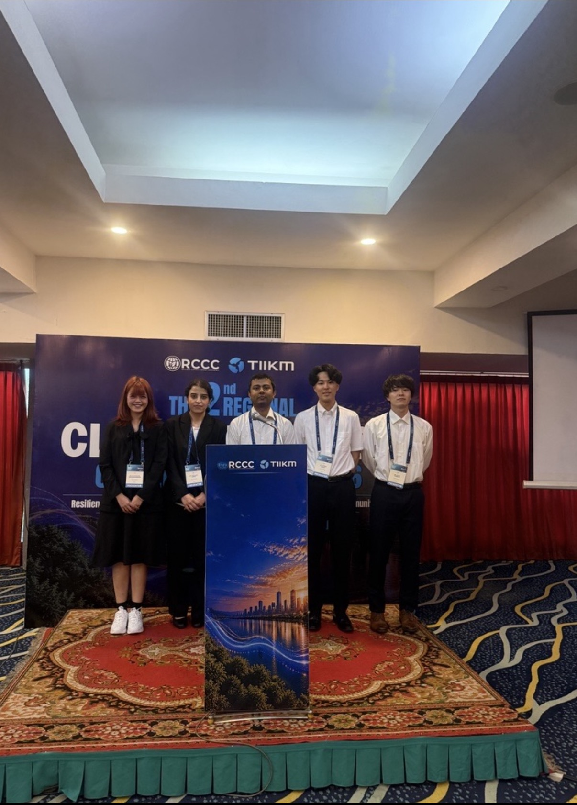
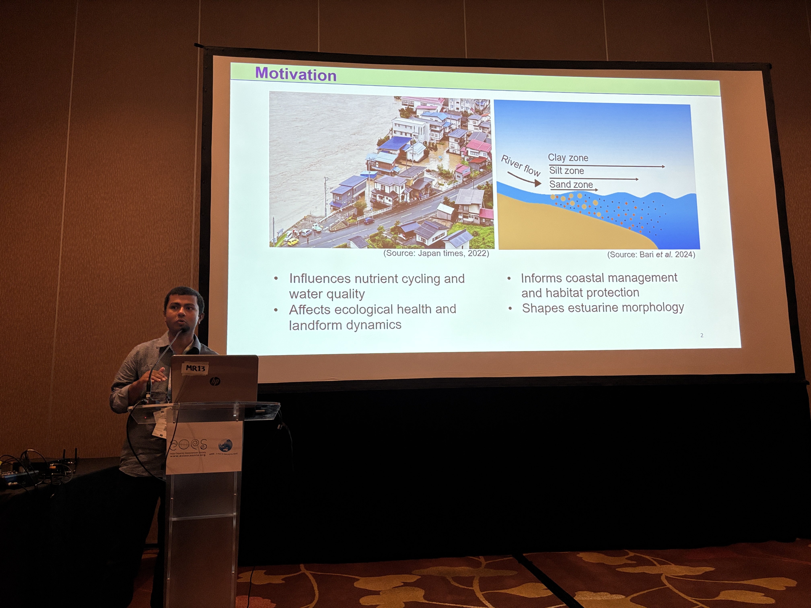

## I have joined RCCC 2026 at Bangkok
**20261015-16**  
I have joined Regional Climate Change Conference (RCCC) 2026 at Bangkok.  
In addition to sharing my own work on sediment transport in mountainous rivers, **I convened** a special session titled **Future Fluvial Sediment Transport and Adaptation**, which fostered discussions on evolving river and coastal dynamics, climate change impact, and future adaptation strategies.  
One of our doctoral students received Best presentation award. Congratulations Minni.

  

RCCC 2026 · Bangkok

---
## I have received 2026 Japan Society of Hydrology and Water Resources (JSHWR) Award
**20260915**  
I have received the **Japan Society of Hydrology and Water Resources Young Author Excellent Article Award**.  
This award recognizes young researchers whose work makes an original and promising contribution to the advancement of hydrology and water resources.  
I’m deeply grateful to the Japan Society of Hydrology and Water Resources for this recognition, and especially thankful to my supervisor and my family for their endless support, encouragement, and belief in me throughout this journey. ❤️  
Research is a continuous journey, and I believe this achievement will encourage me to keep questioning how water environment shapes our lives.  
There is still so much to learn and discover, and I’m excited to continue this journey, contribute to the field, and, hopefully, do research that matters.

---

**2026**
**“Improving rainfall–runoff–inundation model for realistic representations of main river with levees”** Published in *Hydrological Research Letters*.

This study improves hydrological model representation of river levees to better simulate flood dynamics in regulated river systems.

---

  

AOGS Annual Meeting · Singapore

---

### Conference Presentation

**2025 · Conference Presentation**

Presented ongoing research at the *Asia Oceania Geosciences Society (AOGS)* Annual Meeting in Singapore.
