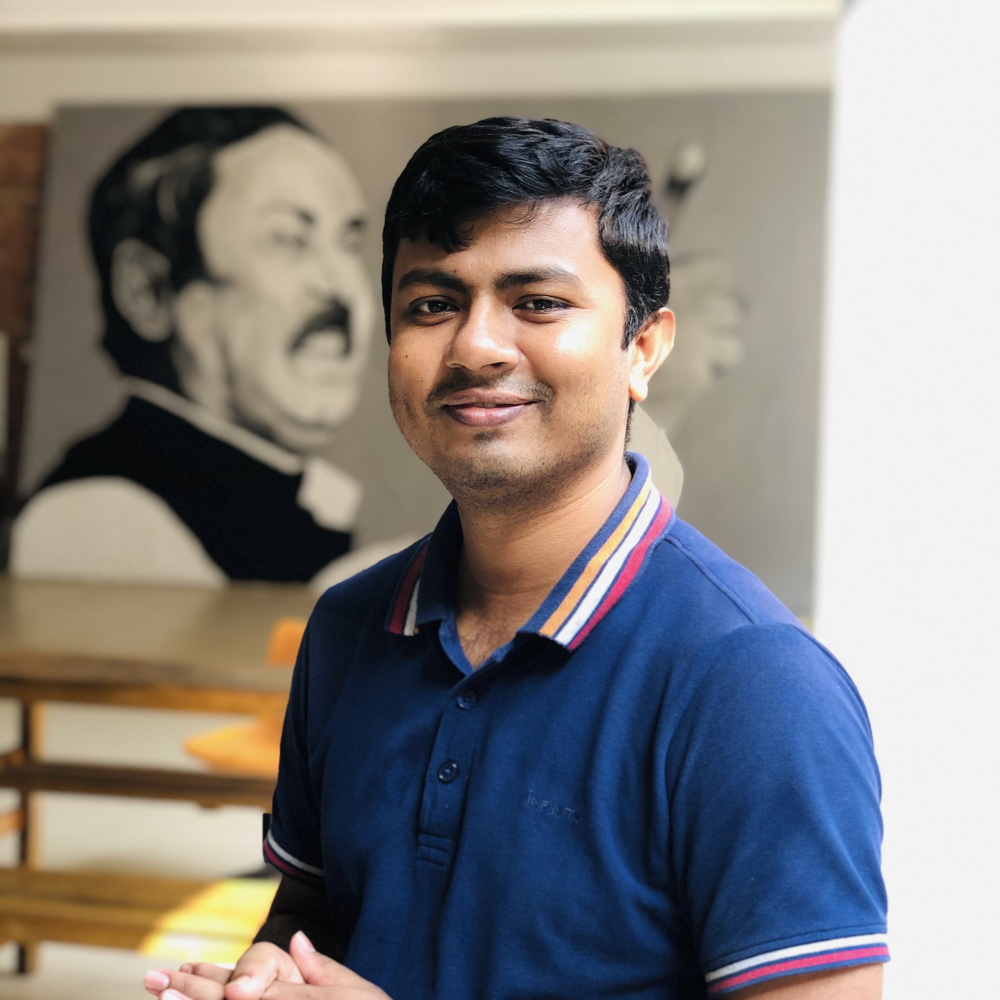

<!-- Top Navigation Bar -->

  <input type="checkbox" id="nav-toggle" class="nav-toggle">
  <label for="nav-toggle" class="nav-toggle-label">☰ Menu</label>
  

    <a href="#about">About</a>
    <a href="Research">Research</a>
    <a href="News">News</a>
    <a href="publications">Publications</a>
    <a href="talks">Talks</a>
    <a href="cv">CV</a>
  

<!-- Header / Profile Section -->

  
  
  <h1 style="font-weight: 700; margin-top: -10px;">Sheikh Hefzul Bari</h1>
  
  

    <strong>Specially Appointed Assistant Professor (Research)</strong>, Tohoku University, Japan 
    <em>Suspended sediment dynamics &bull; Climate change &bull; Compound flooding &bull; River continuum</em>
  

  <!-- Social & Credentials Badges -->
  
  
  
  
  
  

---

<!-- About Section -->
<h2 id="about">About</h2>

I study hydrology and fluvial&ndash;coastal systems in a changing climate, focusing on how hydrological and geomorphological processes shape suspended sediment dynamics from mountain headwaters to river mouths. My research also explores extreme events, with the aim of developing data-driven hazard assessment tools and resilience-oriented adaptation strategies. To achieve this, I use observational and large-ensemble climate simulation data. I am currently working as a <strong>Specially Appointed Assistant Professor at Tohoku University</strong>.

---

<!-- Directory / Interactive Flashcards Grid (2 Cards) -->
<main class="card-grid">
  <!-- Research Card -->
  <a href="Research" class="flashcard">
    

      
Focus Areas

      <h3>Research</h3>
    

    
Hydro-sediment analysis, sediment dynamics, and compound flooding under changing climate.

  </a>

  <!-- News Card -->
  <a href="News" class="flashcard">
    

      
Latest Update

      <h3>News</h3>
    

    

      🏆 Honored 
      Received the <strong>Japan Society of Hydrology and Water Resources (JSHWR) Award</strong>.
    

  </a>
</main>

---

<!-- Footer -->

  

    &copy; 2026 Sheikh Hefzul Bari | Licensed under
    <a href="https://creativecommons.org/licenses/by/4.0/" target="_blank" style="color: var(--link-color);">CC BY 4.0</a>
  

  

    <small>Last updated: 29 June 2026</small>
  

